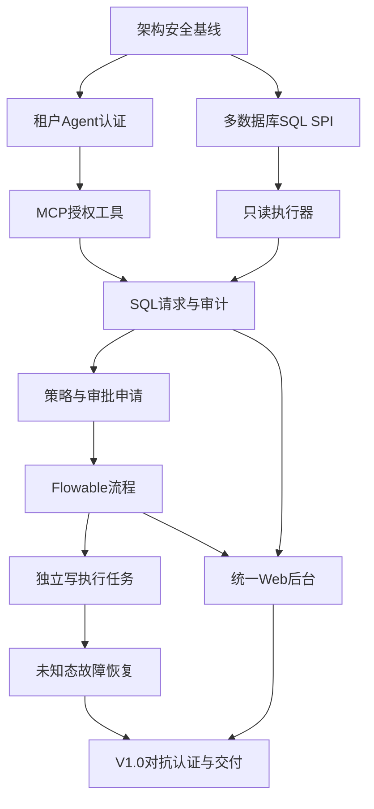

# MCP DataGuard 全量开发任务拆解与里程碑

> 基于 2026-10-21 PRD 的 FR-01～FR-56；56 个需求均有独立开发任务。估算单位 SP 仅用于排序，需迭代计划会重新估算。全部状态为“未实现”，不把脚手架视为完成业务。

## 先行架构门禁（必须优先完成）

- ARCH-BASE：仓库多模块、Java21/Boot4/AI2/Flowable8 BOM，禁用默认公开危险接口，密钥管理，SQL方言SPI。
- SEC-BASE：OIDC受众、租户资源授权与安全拒绝，凭据/网络分区的架构审计，读取最小权限GRANT。
- 测试门禁：PRD AT-01～AT-15 都是 release blocker，不接受仅通过Mock的安全证明。

## 发布路径与交付依赖

| 阶段 | 内容 | 退出标准 |
|---|---|---|
| V0.1 | 只读安全闭环 + MySQL/PG SPI + 身份 + 审计基线 | AT-01/02/03/04/13/14 |
| V0.5 | Flowable 流程 + 业务工单 + 独立写执行器 | AT-05/06/07/08/09/10 |
| V0.7 | Web、安全策略界面、全链路监控 | AT-11 |
| V1.0 | 私有化部署、备份、兼容认证、开源发布 | AT-12/15 及全部 AT |

## 需求实现任务逐条追踪

| Ticket / FR | 工作包 | 任务 | 阶段 | 优先级 | SP | 可验收结果 |
|---|---|---|---|---|---:|---|
| DG-01 / FR-01 | 组织身份 | 创建组织、停用与租户范围过滤 | V0.1 | P0 | 5 | 跨租户资源ID访问统一拒绝 |
| DG-02 / FR-02 | 组织身份 | 本地引导账号与OIDC映射 | V0.1 | P0 | 5 | 生产OIDC受众、签名、过期校验通过 |
| DG-03 / FR-03 | 组织身份 | 角色与库表列授权RBAC | V0.1 | P0 | 3 | 不同角色可见范围完全隔离 |
| DG-04 / FR-04 | 组织身份 | 申请人审批人和执行凭据职责分离 | V0.1 | P0 | 5 | 申请者自批与写凭据访问被拒绝 |
| DG-05 / FR-05 | Agent治理 | Agent注册归属与停用 | V0.1 | P0 | 3 | 禁用Agent下一次调用失败 |
| DG-06 / FR-06 | Agent治理 | OIDC机器身份与委托主体绑定 | V0.1 | P0 | 5 | 伪造agentId无法变更身份 |
| DG-07 / FR-07 | Agent治理 | 工具与数据源对象范围授权 | V0.1 | P0 | 3 | 未授权工具及跨租户数据源拒绝 |
| DG-08 / FR-08 | Agent治理 | 限流并发输出大小超时约束 | V0.1 | P0 | 3 | 限额越界产生可审计错误 |
| DG-09 / FR-09 | 数据源 | 数据源建档和环境标签 | V0.1 | P0 | 3 | 连接参数验证且不得任意JDBC URL |
| DG-10 / FR-10 | 数据源 | 读写凭据SecretRef分离 | V0.1 | P0 | 5 | 管理服务不能读取写凭据 |
| DG-11 / FR-11 | 数据源 | 连接与物理权限测试 | V0.1 | P0 | 8 | READ账户写操作物理拒绝 |
| DG-12 / FR-12 | 数据源 | 元数据列表分页和列权限过滤 | V0.1 | P0 | 8 | 不可见字段不输出 |
| DG-13 / FR-13 | 数据源 | 数据库能力认证矩阵 | V0.1 | P0 | 8 | 未认证写入能力在API与UI都禁用 |
| DG-14 / FR-14 | MCP | list_datasources工具 | V0.1 | P0 | 5 | 仅返回主体有权数据源 |
| DG-15 / FR-15 | MCP | get_schema工具 | V0.1 | P0 | 3 | 按scope分页隐藏字段 |
| DG-16 / FR-16 | MCP | execute_readonly工具 | V0.1 | P0 | 5 | 副作用SQL物理拒绝且返回受限 |
| DG-17 / FR-17 | MCP | check_sql工具 | V0.1 | P0 | 3 | 不执行并返回决策及风险 |
| DG-18 / FR-18 | MCP | submit_change与get_change_status | V0.1 | P0 | 5 | 返回区分审批与执行状态；跨主体不可见 |
| DG-19 / FR-19 | SQL安全 | SQL方言AST转安全上下文 | V0.1 | P0 | 8 | 不支持语法fail-closed |
| DG-20 / FR-20 | SQL安全 | 识别CTE JOIN 函数导出等副作用 | V0.1 | P0 | 5 | SELECT INTO等不判只读 |
| DG-21 / FR-21 | SQL安全 | 安全规则条件模型及评估 | V0.1 | P0 | 3 | 命中正确的租户/环境/对象/风险规则 |
| DG-22 / FR-22 | SQL安全 | 硬拒绝与默认拒绝优先 | V0.1 | P0 | 3 | 审批无法绕过硬拒绝 |
| DG-23 / FR-23 | SQL安全 | 规则版本模拟发布和回滚 | V0.1 | P0 | 3 | 发布为不可变版本并审计 |
| DG-24 / FR-24 | SQL安全 | 物理只读限制与脱敏 | V0.1 | P0 | 3 | 超限截断且只读GRANT生效 |
| DG-25 / FR-25 | SQL安全 | Explain风险评估 | V0.1 | P0 | 3 | 预估标识estimate，不承诺精准 |
| DG-26 / FR-26 | SQL安全 | 危险语法基线与对抗测试 | V0.1 | P0 | 3 | 多语句/无WHERE DELETE/CALL拒绝 |
| DG-27 / FR-27 | Flowable审批 | bpmn-js流程编辑校验 | V0.5 | P0 | 5 | 禁止脚本节点和无审批直通发布 |
| DG-28 / FR-28 | Flowable审批 | 流程草稿发布与版本固化 | V0.5 | P0 | 3 | 在途工单仍用原版本 |
| DG-29 / FR-29 | Flowable审批 | 风险规则绑定流程版本 | V0.5 | P0 | 3 | 按env/operation/risk正确选择 |
| DG-30 / FR-30 | Flowable审批 | 任务箱会签转办拒绝撤回 | V0.5 | P0 | 3 | 审批动作权限与轨迹正确 |
| DG-31 / FR-31 | Flowable审批 | 禁止自批与租户越权 | V0.5 | P0 | 3 | 申请者不可审批自己的工单 |
| DG-32 / FR-32 | Flowable审批 | 提醒到期及超时处理 | V0.5 | P0 | 3 | 超时不可执行、通知无重复 |
| DG-33 / FR-33 | Flowable审批 | Flowable结果到受控执行任务 | V0.5 | P0 | 8 | 批准不直接触发业务SQL |
| DG-34 / FR-34 | 执行器 | 物理只读执行器 | V0.5 | P0 | 8 | 只读账户没有DML权限 |
| DG-35 / FR-35 | 执行器 | 独立写入执行器与Secret | V0.5 | P0 | 8 | MCP进程永不接触写凭据 |
| DG-36 / FR-36 | 执行器 | 精确授权票据校验 | V0.5 | P0 | 3 | 改SQL/参数/库/过期拒绝 |
| DG-37 / FR-37 | 执行器 | 领取租约与未知态恢复 | V0.5 | P0 | 3 | 未知提交不自动重放 |
| DG-38 / FR-38 | 执行器 | 执行记录回执与权限再校验 | V0.5 | P0 | 8 | 记录影响行数和执行错误 |
| DG-39 / FR-39 | 审计监控 | MCP请求证据链 | V0.7 | P0 | 3 | 每请求关联org agent SQL指纹 |
| DG-40 / FR-40 | 审计监控 | Flowable审批事件审计 | V0.7 | P0 | 8 | 每次任务动作有轨迹 |
| DG-41 / FR-41 | 审计监控 | 可过滤的SQL审计及导出 | V0.7 | P0 | 3 | 未授权导出不能取明文 |
| DG-42 / FR-42 | 审计监控 | 实时指标与事件订阅 | V0.7 | P0 | 3 | QPS P95失败率审批积压可见 |
| DG-43 / FR-43 | 审计监控 | 安全告警及去重恢复 | V0.7 | P0 | 3 | 风险事件可去重静默 |
| DG-44 / FR-44 | 审计监控 | 审计哈希链及外部锚定 | V0.7 | P0 | 3 | 篡改能被验出并可归档 |
| DG-45 / FR-45 | Web | BI风格仪表盘与筛选 | V0.7 | P1 | 3 | 组织环境时间筛选正确 |
| DG-46 / FR-46 | Web | 统一Agent数据源规则审批控制台 | V0.7 | P1 | 5 | 功能菜单和API双重授权 |
| DG-47 / FR-47 | Web | 审批与SQL实时状态 | V0.7 | P1 | 3 | 断线恢复不丢状态 |
| DG-48 / FR-48 | Web | 中文国际化与可访问性 | V0.7 | P1 | 3 | 键盘操作和移动审批可用 |
| DG-49 / FR-49 | 开放接口 | REST OpenAPI鉴权和幂等 | V1.0 | P1 | 5 | OpenAPI校验与403/409一致 |
| DG-50 / FR-50 | 开放接口 | Webhook签名重试和死信 | V1.0 | P1 | 5 | 重复事件不重复业务副作用 |
| DG-51 / FR-51 | 开放接口 | 数据库插件SPI SDK | V1.0 | P1 | 3 | 适配器必须过安全认证测试 |
| DG-52 / FR-52 | 开源交付 | Compose一键启动与迁移 | V1.0 | P0 | 5 | 无默认口令镜像源码可构建 |
| DG-53 / FR-53 | 开源交付 | 部署备份恢复与TLS配置 | V1.0 | P0 | 3 | 完整恢复未完工单及审计 |
| DG-54 / FR-54 | 开源交付 | 中英README用户研发手册 | V1.0 | P0 | 5 | 新人仅靠文档可部署演示 |
| DG-55 / FR-55 | 开源交付 | Apache-2.0 NOTICE SBOM 安全响应 | V1.0 | P0 | 5 | 无收费授权依赖许可证合规 |
| DG-56 / FR-56 | 开源交付 | 社区治理ADR测试版本政策 | V1.0 | P0 | 5 | Issue/PR和兼容矩阵公开 |

## 关键依赖 DAG

## 质量要求与 DoD

- 每项功能：PRD/接口/迁移/安全约束/单元测试/集成测试/权限负测/审计字段/文档齐全。
- 安全底线：未知方言与副作用解析失败拒绝；数据库原生只读账号的写入永远失败；同一审批最多一次自动有效执行。
- 每个数据库单独签出 certification.json；未认证功能 API 返回 UNSUPPORTED_CAPABILITY。
- 所有变更需 CI 完成 schema、JSON Schema、BPMN XML、构建、静态检查与对抗测试。
- 开源交付：不含商业授权开关；发布完整源码、Compose、SBOM、LICENSE/NOTICE/SECURITY.md。

## 任务估算汇总

总计 **56 个 FR 级任务，247 SP 粗估**（不包含基础架构、安全测试、联调开销）。